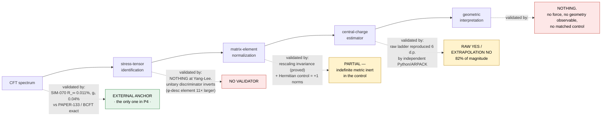

# ana:dependency-graph — Claim Dependency Graph

**Auditor task:** `ana:dependency-graph`.
**Governing standard:** `docs/governance/RESEARCH-DIRECTOR.md` §38C (dependency analysis), §15 (claim
dependency chains), §7 (independence ledger), §5/§6 (contribution level, counterfactual novelty),
§12 (killer tests), §16 (no-go), §34 (state vs representation).
**Date:** 2026-08-17. **Repo state:** branch `public-release`, HEAD `9470d69`.
All paths repo-relative to `D:/quantum-worldline/`.

**Inputs.** Phase-1 artifacts in `research/data/audit/raw/` (`inv-pipelines.md`, `inv-sims-early.md`,
`inv-sims-late.md`, `inv-hypotheses.md`, `inv-manuscript-claims.md`, `inv-errata-history.md`,
`inv-infrastructure.md`), plus direct re-reads of the records and drivers cited below. Where I relied
on a phase-1 auditor's recomputation rather than my own, I say so at the point of use.

---

## 0. Headline

**Every quantitative claim in the program terminates in one of three primitive nodes: an exact CFT
identity, an architectural constant the ansatz defines rather than measures, or a lattice→CFT
operator identification imported from external work.** The graph has no edge that carries geometric
information independent of those three. Two chains are genuinely circular in the §38C sense — a claim
whose support ultimately derives from itself — and I name them CIRC-1 (the α = 4 universality gate is
the α = 4 result) and CIRC-4 (the Yang-Lee extrapolator's credential is the selection that produced
it). Three more are algebraically self-supporting (CIRC-3, CIRC-5, CIRC-6).

The §15 chain analysis below locates the exact link at which validation stops in each flagship
inference. In both flagships it is the **same structural place**: the numerical success validates the
*estimator arithmetic* and the *convergence of the state*, and the next link — operator/state
identification in one chain, geometric interpretation in the other — has **no independent validator
in the repository at all**.

---

## 1. Node taxonomy — the dependency primitives

Ten classes, matching §38C's list plus three the repository forced me to add (P2 architectural
constants, P8 fit-window/estimator choices, P9 pre-registered acceptance windows). Every claim edge
below resolves into these.

### P1 — External exact identities (measurement impossible; only implementation can fail)

| id | identity | value | source of record |
|---|---|---|---|
| P1-a | Δ_T = 2 in **every** 2D CFT (T has weights (2,0)⊕(0,2)) | 2 | `research/submission-package/prd/paper-prd.tex:427` states it as "a kinematic constant of conformal symmetry" |
| P1-b | α = 2Δ_T for boundary two-point stress-tensor exchange | 4 | `paper-prd.tex:427,439,531` |
| P1-c | C_TTT = 2√2/√c (Virasoro) | — | `research/tools/cttt-circle/qw_cttt_circle.py:203`; `research/tools/pumps-setup/qw_cttt_of.jl:14`; `qw_cttt_potts3.jl:16` |
| P1-d | ⟨T\|T⟩ = c/2 (Virasoro norm) | — | `research/tools/yanglee-pt/qw_yanglee_ks.jl:13` driver comment |
| P1-e | C_σσε = 1/2 for Ising (BPZ 1984) | 0.5 | `research/data/simulations/SIM-2026-056.json` `cft_target.source` = PEV arXiv:0810.0580 Eq.15 |
| P1-f | minimal-model c and Δ: (1/2, 7/10, 4/5, −22/5) and their primary towers | — | `SIM-2026-051.json` `cft_targets_TCI_M45`; `SIM-2026-063.json` `results` |
| P1-g | AdS mass–dimension relation m²l² = Δ(Δ−2) | −1 at Δ=1 | `research/data/simulations/effective_mass_analysis.json` `ads_mass_dimension.epsilon_m_squared_l2` = −1.0 |
| P1-h | embedding-space null condition ⇒ T = (π/2)·l_AdS | π/2 | `composite_geodesic_results.json` `calculations.embedding_space`, `T_lightlike_radians` = 1.5707963 |
| P1-i | Koo–Saleur H_n ≈ L_n + L̄_{−n} | — | `SIM-2026-067.json` cites Zou–Milsted–Vidal arXiv:1710.05397 (PRL 121 230402) |
| P1-j | Yang-Lee BCFT boundary data R_∞ = −(1+√5)/2, g₁ = 0.725073 | — | `SIM-2026-070.json`; source PDF `research/downloads/2606.16785v2.pdf` (PAPER-133) |
| P1-k | Ising fusion rule ε×ε = [**1**] (excludes a Δ=1 intermediate) | — | `paper-prd.tex:563-569`, citing `DiFrancesco1997` |

**All P1 nodes have counterfactual novelty ≈ 0 (§6).** Before any run, the only possible outcomes
were "the implementation reproduces it" or "the implementation is broken."

### P2 — Architectural constants (defined by the ansatz, never measured)

| id | constant | value | where fixed |
|---|---|---|---|
| P2-a | l_AdS ≡ 1/ln χ = 1/ln 2 | 1.4426950408889634 | `paper-prd.tex:64` — "**This value is set by the MERA architecture, not by optimization**"; stored as `SIM-2026-001.json` `results.analytical.l_AdS` |
| P2-b | d_geo = 2·l_AdS·ln(dr) (MERA graph geodesic) | — | `paper-prd.tex:529` |

P2-a is the single most load-bearing constant in the manuscript: it enters Result 2 (transport
prediction), Result 4 (m_eff), and the geodesic reinterpretation of Result 1. It is a **definition**.

### P3 — Lattice→CFT operator and state identifications (imported, not derived here)

| id | identification | where |
|---|---|---|
| P3-a | boundary primary σ_j = 0.635(X_j+X_{j+1}) − 0.026(X_jZ_{j+1}+Z_jX_{j+1}) | `paper-prd.tex:275`, cited to `ZouMilstedVidal2020`; stored `SIM-2026-011-interaction.json` `boundary_primary_coeffs` = {alpha 0.635, beta −0.026} |
| P3-b | unitary T-identification rule: element dominance + Δ-plausibility gate | `SIM-2026-068.json` `method`; `qw_cttt_circle.py` `method_notes` (2) records that naive max-element was **falsified** for band-edge states |
| P3-c | Yang-Lee vacuum = the **2nd** k=0 state (\|1⟩), physical GS = \|φ⟩ with Δ_φ = −2/5 | `qw_yanglee_ks.jl:84` (`ivac = i0[2]`); `SIM-2026-071.json` `method` |
| P3-d | Yang-Lee T-identification: Δ-gate (1.75, 2.25) above vacuum | `qw_yanglee_ks.jl:124` |
| P3-e | η = parity left-pairing (left = P·right) | `qw_yanglee_ks.jl:93` `lv(i) = conj.(vecs[i][pp])` |

### P4 — Numerical state construction

| id | pipeline | tracked at |
|---|---|---|
| P4-a | exact sparse ED (`eigsh` / KrylovKit) | `SIM-2026-011-interaction.json` `ground_state.method`; `research/tools/cttt-circle/qw_cttt_circle.py` |
| P4-b | VQE binary MERA χ=2/χ=3 + ALM/Z₂-projection | `SIM-2026-008c.json`, `SIM-2026-015c.json` |
| P4-c | scale-invariant ternary MERA, Z₂/Z₃-graded (MERAKit) | `research/tools/merakit-setup/` |
| P4-d | puMPS Bloch states (vendored ZMV, commit `0557b12a…`) | `research/tools/pumps-setup/VENDOR.md:10-12` |
| P4-e | biorthogonal non-Hermitian ED | `research/tools/yanglee-pt/qw_yanglee_ks.jl` |

### P5 — Extraction estimators
`E1` power-law fit F ~ A·dr^{−α} over a chosen window · `E2` MERA scaling-superoperator spectrum → Δ ·
`E3` Koo–Saleur matrix element → c = 2\|M_T\|² · `E4` PEV route → OPE constants ·
`E5` 1/N² linear extrapolation · `E6` three-parameter c(N)=c_∞+aN^{−p} ·
`E7` two-level Richardson (pairwise 1/L intercepts + geometric tail) · `E8` h_c^∞ fit model.

### P6 — Normalization choices
`N1` velocity: **exact v = 2** (P2 pipeline, `qw_cttt_circle.py`, `v_used = 2.0`) vs **v_T imposed
from Δ_T ≡ 2** (P3/P4 pipelines) · `N2` biorthogonal pairing η = P · `N3` eigenvector rescaling
(**proved invariant**, see §3 link A3) · `N4` excited-state normalization
(`SIM-2026-011-interaction.json` `norms_single` ≈ 1.13, `norms_dual` ≈ 1.28 — unnormalized).

### P7 — Interpretive assumptions (no measurement attaches)
`I1` MERA *is* a discrete AdS geometry · `I2` α = 4 ⇒ graviton/stress-tensor exchange in a bulk ·
`I3` transport dip/reappearance ⇒ a null geodesic traversal · `I4` "quantum gravity in ADM superspace
= worldline path integral on AdS = measurable MERA observables" (`paper-prd.tex:231`) ·
`I5` c_KS < 0 ⇒ the stress-tensor exchange amplitude "changes character" (`SIM-2026-071.json`
`key_findings[3]`).

### P8 — Fit-window and estimator selections (free choices that move the answer)
`W1` α fit window dr ≥ 2 · `W2` YL h_c^∞ model (b free / b=12/5 / b=12/5+L^{−4}) ·
`W3` Richardson tail ratio (mean vs last) · `W4` C_TTT extrapolated directly vs derived from c ·
`W5` best-basin selection in MERA runs.

### P9 — Pre-registered acceptance windows
`A1` α ∈ [3.2, 4.8] — `SIM-2026-023.json` `emulator_acceptance_window`, rationale verbatim:
*"Within 20% of 4.0 per HYP-017 publication threshold"*.

---

## 2. The graph

```mermaid
graph TD
  %% ============ PRIMITIVES ============
  subgraph EXT["P1 · External exact identities — counterfactual novelty ≈ 0"]
    ID_DT["Δ_T = 2 in every 2D CFT"]
    ID_ALPHA["α = 2Δ_T"]
    ID_CTTT["C_TTT = 2√2/√c"]
    ID_TT["⟨T|T⟩ = c/2"]
    ID_BPZ["C_σσε = 1/2 · BPZ 1984"]
    ID_MM["minimal-model c, Δ towers<br/>1/2 · 7/10 · 4/5 · −22/5"]
    ID_MASS["m²l² = Δ(Δ−2)"]
    ID_NULL["null condition ⇒ T = (π/2)·l_AdS"]
    ID_KS["Koo–Saleur H_n ≈ L_n + L̄_−n<br/>ZMV PRL 121 230402"]
    ID_YLB["Yang-Lee BCFT R_∞, g₁<br/>PAPER-133"]
    ID_FUS["fusion ε×ε = identity only"]
  end

  subgraph ARCH["P2 · Architectural constants — defined, not measured"]
    LADS["l_AdS ≡ 1/ln χ = 1.4427"]
    DGEO["d_geo = 2·l_AdS·ln dr"]
  end

  subgraph OPID["P3 · Operator / state identification — imported"]
    ZMVOP["ZMV boundary primary σ_j<br/>0.635 / −0.026"]
    TRULE["unitary T-ID: element dominance"]
    YLVAC["YL vacuum = 2nd k=0 state"]
    YLGATE["YL T-ID: Δ-gate (1.75, 2.25)"]
    ETA["η = P left-pairing"]
  end

  %% ============ STATE CONSTRUCTION ============
  subgraph STATE["P4 · State construction"]
    ED["exact sparse ED"]
    VQE["VQE binary MERA χ=2/3<br/>ALM + Z₂ projection"]
    SIMERA["scale-inv ternary MERA<br/>Z₂/Z₃-graded"]
    PUMPS["puMPS Bloch states<br/>vendored ZMV 0557b12a"]
    NHED["biorthogonal non-Herm ED"]
  end

  %% ============ MEASURED / DERIVED QUANTITIES ============
  DELTAS["Δ_σ, Δ_ε, Δ_T<br/>SIM-051/052/057/059/062/063"]
  OPE["C_σσε = 0.50 ± 0.03<br/>SIM-061 / 064"]
  CMEAS["c from KS element<br/>SIM-067 / 068 / 069"]
  CKS["c_KS ladder −1.41 … −2.36<br/>SIM-071 raw, L = 10…18"]
  FDR["F(dr) interaction energy<br/>SIM-011-interaction"]
  TTRANS["T_measured = 2.239<br/>SIM-025 grid-converged"]
  XIMERA["ξ_2pt = 2.154 · two points<br/>V(2)/V(1) on SIM-002"]

  %% ============ ESTIMATORS ============
  E1["E1 · power-law fit, window dr≥2"]
  E5["E5 · 1/N² extrapolation"]
  E6["E6 · c_∞ + aN^−p"]
  E7["E7 · two-level Richardson<br/>+ geometric tail"]
  E8["E8 · h_c^∞ fit model"]

  %% ============ CLAIMS ============
  CL1["CL-1 α = 3.92 ± 0.16<br/>PAPER RESULT 1"]
  CL2["CL-2 α = 4 universal<br/>at 3 classes"]
  CL3["CL-3 T = (π/2)·l_AdS to −1.21%<br/>PAPER RESULT 2"]
  CL4["CL-4 m_eff 0.693 vs 0.670<br/>PAPER RESULT 4"]
  CL5["CL-5 two-phase Z₂ optimizer<br/>1.12% / 3.33% · PAPER RESULT 3"]
  CL7["CL-7 C_σσε = 0.50 ± 0.03"]
  CL8["CL-8 C_TTT ladder<br/>3.9936 / 3.381 / 3.163"]
  CL9["CL-9 c_KS = −4.29 ≈ true c = −22/5"]
  CL10["CL-10 c_eff = +2/5 EXCLUDED"]
  CL11["CL-11 L₋₂ε suppression ~400×<br/>METHOD"]
  CL12["CL-12 Route A closed<br/>NEGATIVE"]

  %% ============ INTERPRETATION ============
  subgraph INTERP["P7 · Interpretive layer — no validator in repo"]
    I1["MERA IS a discrete AdS geometry"]
    I2["α = 4 ⇒ graviton exchange"]
    I3["dip/reappearance ⇒ null geodesic"]
    I4["ADM superspace = worldline = MERA"]
    I5["c_KS < 0 ⇒ exchange changes character"]
  end

  %% ============ EDGES: force chain ============
  ED --> FDR
  ZMVOP --> FDR
  ID_MM --> ZMVOP
  FDR --> E1 --> CL1
  ID_FUS --> CL1
  ID_ALPHA --> CL1
  ID_DT --> ID_ALPHA
  CL1 --> I2
  DGEO --> I2
  LADS --> DGEO
  I2 --> I1

  %% ============ EDGES: universality ============
  SIMERA --> DELTAS
  ID_MM --> DELTAS
  DELTAS --> CL2
  ID_ALPHA --> CL2
  CL2 --> I1
  CL2 -.->|"NO force fit exists<br/>in SIM-051/052/062/063"| CL1

  %% ============ EDGES: transport ============
  ED --> TTRANS
  SIMERA --> TTRANS
  ID_NULL --> CL3
  LADS --> CL3
  TTRANS --> CL3
  CL3 --> I3
  I3 --> I1

  %% ============ EDGES: m_eff ============
  ID_MASS --> CL4
  LADS --> CL4
  VQE --> XIMERA
  XIMERA --> CL4
  LADS --> XIMERA
  CL4 --> I4

  %% ============ EDGES: optimizer ============
  VQE --> CL5

  %% ============ EDGES: OPE ============
  SIMERA --> OPE
  ID_BPZ --> CL7
  OPE --> CL7

  %% ============ EDGES: C_TTT ladder ============
  ED --> CMEAS
  PUMPS --> CMEAS
  ID_KS --> CMEAS
  TRULE --> CMEAS
  ID_DT -->|"v_T ≡ imposing Δ_T = 2<br/>in SIM-068/069"| CMEAS
  CMEAS --> E5 --> CL8
  CMEAS --> E6 --> CL8
  ID_CTTT -->|"C_TTT computed as this line"| CL8
  ID_TT --> ID_CTTT
  PUMPS --> CL11
  SIMERA --> CL12

  %% ============ EDGES: Yang-Lee ============
  NHED --> CKS
  ID_KS --> CKS
  ETA --> CKS
  YLVAC --> CKS
  YLGATE --> CKS
  ID_MM --> YLVAC
  ID_MM --> YLGATE
  ID_DT -->|"v_T ≡ imposing Δ_T = 2<br/>c_KS ∝ Δ_T²"| CKS
  ID_YLB --> E8
  E8 -->|"h_c^∞ = 1.5587127<br/>sets working point"| CKS
  CKS --> CL10
  CKS --> E7 --> CL9
  ID_MM --> CL9
  CL9 --> I5
  ID_CTTT --> I5

  %% ============ CIRCULAR EDGES ============
  CL2 ==>|"CIRC-1 · gate is the result"| DELTAS
  CL8 ==>|"CIRC-5 · side A = side B"| CMEAS
  CL4 ==>|"CIRC-6 · l_AdS on both sides"| LADS
  E7 ==>|"CIRC-4 · estimator credential<br/>= the selection that made it"| ID_YLB

  classDef ident fill:#fde7e7,stroke:#c0392b,color:#000
  classDef arch fill:#fff3cd,stroke:#b8860b,color:#000
  classDef interp fill:#e8e8f5,stroke:#5b5bd6,color:#000
  classDef claim fill:#e6f4ea,stroke:#1e7e34,color:#000
  class ID_DT,ID_ALPHA,ID_CTTT,ID_TT,ID_BPZ,ID_MM,ID_MASS,ID_NULL,ID_KS,ID_YLB,ID_FUS ident
  class LADS,DGEO arch
  class I1,I2,I3,I4,I5 interp
  class CL1,CL2,CL3,CL4,CL5,CL7,CL8,CL9,CL10,CL11,CL12 claim
```



**How to read it.** Red = exact identity (P1), amber = architectural definition (P2), green = project
claim, blue = interpretation. **Every green node has at least one red or amber parent.** The four
double-arrow edges are the circular dependencies of §4. The dashed edge from CL-2 to CL-1 is the one
the manuscript asserts and the records do not support: no force fit exists in any universality record.

### 2.1 Sub-graph — the flagship §15 chain, drawn as the standard names it



---

## 3. §15 chain analysis

Two flagships exist and they are different objects: the **submitted manuscript's** flagship (α = 4
force → emergent geometry) and the **governance document's** designated "strongest current frontier
result" (`RESEARCH-DIRECTOR.md` §3, Yang-Lee biorthogonal Koo–Saleur). The §15 template in the task
brief — *CFT spectrum → stress-tensor identification → matrix-element normalization → central-charge
estimator → geometric interpretation* — is literally the Yang-Lee chain, so I analyse it first and in
full, then apply the same discipline to the manuscript chain and the transport chain.

For each link: **what it asserts**, **what validates THAT link specifically**, **what does not**, and
a verdict.

---

### 3.A Chain A — Yang-Lee biorthogonal Koo–Saleur (SIM-070 → SIM-071 → HYP-028)

```
P1-j PAPER-133 method (η = P pairing; PT-edge working point)
  └─> [A0] h_c^∞ = 1.5587127            (E8 fit-model choice, W2)
        └─> [A1] CFT spectrum identification of the finite chain
              └─> [A2] stress-tensor identification (which state is T)
                    └─> [A3] matrix-element normalization (v_T, biorthogonal pairing)
                          └─> [A4] central-charge estimator (raw ladder + E7 Richardson)
                                └─> [A5] geometric / physical interpretation
```

#### [A0] working point — `h_c^∞ = 1.5587127`
**Asserts:** the finite-size exceptional points `h_c^L` extrapolate to this value, which is the
PT-unbroken critical working point for Phase 2.
**Validates this link:** the `h_c^L` table itself is a bisection on Im(E) and is tracked
(`SIM-2026-070.json:8`); `inv-pipelines.md` §5.8 and `inv-sims-late.md` §2 both re-fitted it
independently and recovered 1.5587127 to 7 digits. The exponent b = 12/5 is theory-fixed (= y_φ).
**Does NOT validate:** the *choice of fit model*. `inv-pipelines.md` §5.6 measured the three
defensible models and found they move the Phase-2 headline from **−3.67 to −4.29 to −7.04** — a ~3×
lever arm. `SIM-2026-071.json:27` states the residual `h_c^∞` error contributes "≤0.01"; the measured
value is 0.056 at L=16 for the record's own Δh.
**Verdict:** VALIDATED AS A FIT, NOT AS A CHOICE. This is a P8 free parameter with the largest
single lever arm in the chain and it is not in the quoted uncertainty band.

#### [A1] CFT spectrum → the finite chain carries M(2,5)
**Asserts:** at `h = h_c^∞` the low k=0 and k=±2 states of `H_YL = −Σ(σᶻσᶻ + λσˣ + i h σᶻ)`, λ=4, are
the Yang-Lee M(2,5) modules: |φ⟩ (physical GS, Δ_φ = −2/5), |1⟩ (conformal vacuum, 2nd k=0 state),
one φ-descendant at Δ_vac → 1.6, and T at Δ_vac → 2.
**Validates this link:**
- The **only fully external anchor in the whole program's frontier work**: SIM-070 reproduces
  PAPER-133's `R_∞ = −(1+√5)/2` at 0.011% and `g₁ = 0.725073` at 0.04%
  (`SIM-2026-070.json`; corroborated line-for-line by the tracked `research/tools/yanglee-pt/yl_proj.log`,
  which also shows **Z₁ negative at every L** with |Im| ≤ 2.9e-10 — a unitarity-forbidden sign).
  `inv-sims-late.md` §2 re-derived every intercept.
- Δ_vac(T) rises monotonically 1.94471 → 1.98236 over L = 10…18 (raw `Dvac[2]`,
  `research/tools/yanglee-pt/qw_yanglee_ks_results.jsonl`), consistent with Δ_T = 2.
**Does NOT validate:**
- HYP-028's **own mandatory gate** was never run. `HYP-2026-028.json:24` requires *"confirm c_eff=2/5
  via ... biorthogonal entanglement-entropy scaling AND Delta_phi ... BEFORE reporting alpha"*.
  `HYP-2026-028.json:54` records the gate as satisfied "via SIM-070 + SIM-071" — but SIM-070 measured
  `g₁` and `R_∞`, which are **boundary-state g-function data, not c_eff and not Δ_φ**
  (`inv-pipelines.md` §5.9). Neither registered quantity exists anywhere.
- The φ-descendant sits at Δ_vac = **1.524** at L=18 against the predicted 1.6 — 4.8% short. SIM-071
  calls the cluster structure a match "**exactly**" (`SIM-2026-071.json` `spectrum_checks`);
  `inv-sims-late.md` §2 flags the word.
- A **third** k=±2 state at Δ_vac = 3.015 → 3.355 is neither identified nor discussed in any record.
**Verdict:** VALIDATED BY AN EXTERNAL ANCHOR, but against a *substituted* observable. The substitution
is scientifically defensible and undocumented (§36 violation).

#### [A2] stress-tensor identification — "the state in (1.75, 2.25) above |1⟩ is T"
**Asserts:** the k=±2 state whose Δ_vac falls in the Δ-gate window is the stress tensor.
**Validates this link:** *In the unitary control*, element dominance and the Δ-gate **agree** — at
Ising L=12 two states fall in the window (Δ_vac 1.9575, 2.0321) and dominance picks the right one
(0.27259 vs a Z₂ structural zero). Independently, `qw_cttt_circle.py` `method_notes` (2) records that
naive max-element identification was **tested and falsified** for lattice band-edge states, and
`SIM-2026-068.json` `key_findings[2]` documents a real T/L₂σ level-ordering flip at N=14 that
dominance handled correctly. So the rule has a genuine track record — **in unitary chains**.
**Does NOT validate:** *At Yang-Lee the discriminator inverts and there is nothing left.*
- Cluster products at L=18: **+28.451** (φ-descendant, Δ_vac 1.524), **−2.588** (T, Δ_vac 1.982),
  −7.335 (Δ_vac 3.355) — raw `prods`/`Dvac` in `qw_yanglee_ks_results.jsonl`, confirmed by
  `inv-sims-late.md` 071.3c. T carries the **smallest** element in the cluster: 11.0× smaller than the
  φ-descendant, 2.8× smaller than the third state.
- Only one state falls inside (1.75, 2.25) at every L, so `jT = cand[argmax(...)]`
  (`qw_yanglee_ks.jl:127`) is a **no-op**: T is selected **by energy alone**.
- The window's units come from `v`, which is computed from the 1−φ split **assuming Δ_φ = −2/5**
  (`qw_yanglee_ks.jl:86`). So M(2,5) theory selects the state.
- Had the unitary rule been applied, `c_KS ≈ +13.8 at L=10` — **positive**
  (`inv-sims-late.md` 071.3c). **The sign of the headline is a consequence of the gate choice.**
**Verdict:** **THIS IS THE FIRST LINK IN THE CHAIN WITH NO INDEPENDENT VALIDATOR.** It is
pre-registered (`research/tools/yanglee-pt/HYP028-BIORTHO-KS-DESIGN.md` Phase-2 refinements 2–4,
written before the run), which makes it honest, and structurally dependent, which makes it not
evidence. Within this experiment the identification is unfalsifiable.

#### [A3] matrix-element normalization
**Asserts:** `c_KS = 2·⟨1_L|H_{−2}|T_R⟩⟨T_L|H_{+2}|1_R⟩ / (⟨T_L|T_R⟩⟨1_L|1_R⟩) · (L/2πv_T)²`
with `v_T ≡ (E_T − E_vac)·L/(2π·2.0)` and left = P·right.
**Validates this link:**
- **Eigenvector-rescaling invariance, proved.** Under ψ_R → α·ψ_R the numerator gains |α|² and
  `biod(i,i)` gains |α|², which cancel; likewise for the vacuum
  (`inv-pipelines.md` §5.5, `inv-sims-late.md` 071.2 — both derived it independently from
  `qw_yanglee_ks.jl:93-94,109-129`). This **retires one branch of §12's Yang-Lee method killer**
  ("arises from a normalization convention") for the rescaling sub-case. It is claimed nowhere in the
  project's own records.
- η = P is genuine pseudo-Hermiticity: `P σᶻ P = −σᶻ` ⇒ `P H_YL P = H_YL†` (verified analytically by
  `inv-sims-late.md` 071.2).
- The Ising control returns the correct prefactor: 0.49986 vs 0.5 (0.03%).
**Does NOT validate:**
- **The control switches the mechanism off.** `qw_yanglee_ks.jl:25` sets `HC = 0.0` in Ising mode, so
  the `−im*h*mz` term vanishes identically and H is real symmetric. Biorthogonal norms are then
  **exactly +1.000000** — the record says so itself (`SIM-2026-071.json:11`). 148 of 152 lines are
  shared (`inv-pipelines.md` §5.3). Indefinite metric, left ≠ right, non-normality and conditioning
  are **never exercised**. Under §19 this control cannot defeat the interpretation.
- **The left vector is assumed, never solved.** `H^T w = E w` is never computed; only `w = P v` is
  used (`qw_yanglee_ks.jl:93`). §13 Q2/Q3 untested by experiment.
- **Cross-state biorthogonality is never computed.** `HYP028-BIORTHO-KS-DESIGN.md:36` mandates it;
  the driver only ever evaluates `biod(i,i)` (lines 95, 111, 117).
- **Δ_T = 2 is imposed, and it sets the scale.** Substituting v_T, `c_KS = 2·prod·(Δ_T^assumed/ΔE)²`,
  i.e. **c_KS ∝ (Δ_T^assumed)²**. `inv-sims-late.md` 071.2 notes v_T and L cancel identically. The CFT
  normalization is an input to the number, not a check on it.
- **The designated EP health metric is degrading unremarked.** ⟨T_L|T_R⟩ falls 0.09615 → 0.005539 over
  L = 10…18 (raw `Tnorm`), ~2.03× per ΔL=2, i.e. exponential; ⟨1|1⟩ falls ~2.65× per ΔL=2 and is
  **negative** (−0.010656, −0.003996, −0.001507 at L=10/12/14 — measured by `inv-pipelines.md` §5.2,
  the first artifact ever produced for that claim). No threshold, no alarm, no discussion.
**Verdict:** **PARTIALLY VALIDATED.** The estimator's *algebra* is validated and one killer branch is
provably closed. The **biorthogonal layer — the actual novel content — has no validator at all.**

#### [A4] central-charge estimator
**Asserts:** `c_KS(L)` = (−1.413195, −1.702883, −1.953729, −2.169926, −2.356244) at L = 10…18, and
its limit is −4.285, quoted as −4.29 ± 0.15.
**Validates this link:**
- **A genuinely independent code path exists — produced by this audit, not by the project.**
  `inv-pipelines.md` §5.2 re-implemented the driver in Python with ARPACK instead of KrylovKit and
  reproduced **all five Yang-Lee values and all three unitary-control values to 6 decimals**. The raw
  measurements are real.
- Both chiralities agree to ~1e-11 (`qw_yanglee_ks_results.jsonl`); the sign is negative at every L,
  machine-real.
**Does NOT validate:** the extrapolation.
- The largest-L datum is −2.356; the quoted limit is −4.285. **82% of the magnitude is estimator**
  (`inv-sims-late.md` 071.3a).
- The geometric tail's ratio is estimated from **two** samples (0.730, 0.728).
- The ±0.15 band "is not derived from any stated procedure" and does not cover r = 0.80
  (sweep: r = 0.65 → −4.150; 0.728 → −4.285; 0.80 → −4.501).
- The h_c^∞ model spread alone (A0) spans **[−7.04, −3.67]**.
**Verdict:** **RAW LADDER VALIDATED; LIMIT NOT.** The split is clean and consequential:
**CL-10 (c_eff = +2/5 excluded, by sign, at every L) needs no extrapolation and stands.**
**CL-9 (= −22/5 to 2.6%) is 18% data.**

#### [A5] geometric / physical interpretation
**Asserts:** "the Koo–Saleur stress-tensor construction SURVIVES non-unitarity and measures the TRUE
central charge... The biorthogonal element structure sees what the energy spectrum cannot"
(`SIM-2026-071.json` `key_findings[0]`) and "C_TTT = 2√2/√c is IMAGINARY at c < 0 — the graviton
self-coupling does not survive as a real amplitude... the stress-tensor exchange amplitude changes
character" (`key_findings[3]`).
**Validates this link:** **nothing in the repository.**
- The "imaginary C_TTT" observation is `2√2/√(negative number)` — arithmetic on the P1-c identity,
  not a measurement of anything.
- **No α was measured at Yang-Lee**, which is what HYP-028 actually registered
  (`HYP-2026-028.json:5` `claim`, `:16` `refutation_criteria`). `inv-hypotheses.md` finding 2 and
  `inv-sims-late.md` §4 both establish this independently.
- No geometric observable, no matched non-geometric control. `inv-pipelines.md` §6.3 records:
  *"Any geometry-discriminating result (§5, Level 4) — none exists in any pipeline."*
- **The novelty claim has no gate.** `SIM-2026-071.json` `key_findings[1]` reads *"First lattice
  extraction (to our knowledge) of a NEGATIVE central charge from stress-tensor matrix elements"* — a
  phrase §8 forbids without recorded evidence, and no literature-gate record exists anywhere in
  `research/data/papers/`, `research/data/theory/`, `NEXT-SESSION.md`, or `HYP-2026-028.json`.
**Verdict:** **UNVALIDATED. THE CHAIN STOPS HERE.**

#### Chain A summary — where validation stops, precisely

| link | validator | strength |
|---|---|---|
| A0 working point | own fit, reproduced twice | fit YES / model choice NO — 3× lever arm |
| A1 spectrum | PAPER-133 external anchor, 0.011% / 0.04% | **strong, but a substituted observable** |
| A2 T-identification | — | **NONE. Discriminator inverts; T selected by theory** |
| A3 normalization | rescaling invariance (proved); Hermitian control | **algebra YES / biorthogonal layer NO** |
| A4 estimator | independent Python/ARPACK reproduction (this audit) | **raw YES / extrapolation NO** |
| A5 interpretation | — | **NONE** |

> **The precise §15 statement.** *The unitary control's numerical success (c_KS → 0.49986 vs exact 0.5)
> validates the Koo–Saleur estimator's arithmetic — link A3's prefactor and link A4's functional form.
> It validates **nothing** in link A2, because in the unitary case the identification is trivial and
> the discriminator agrees with the gate; and it validates **nothing** in link A5, because the control
> has no geometric content. The one link on which the entire novelty claim rests — that a
> **biorthogonal** pairing on a **non-normal** operator still projects onto the Virasoro T module — is
> the one link with no validator on either side of the control.*

---

### 3.B Chain B — the manuscript's flagship: α = 4 → emergent geometry

```
P1-f minimal-model data ─> P3-a ZMV boundary primary σ_j
  └─> [B1] operator identification
        └─> [B2] observable F(dr) = E_dual − E_0 − 2δE_single
              └─> [B3] exponent extraction (power-law fit, window dr ≥ 2)
                    └─> [B4] "α = 2Δ_T ⇒ stress-tensor exchange"
                          ├─> [B5] universality: α = 4 at TCI and Potts
                          └─> [B6] "graviton exchange in an emergent AdS bulk"
```

#### [B1] operator identification
**Asserts:** σ_j = 0.635(X_j+X_{j+1}) − 0.026(X_jZ_{j+1}+Z_jX_{j+1}) creates a boundary primary
excitation (`paper-prd.tex:275`; `SIM-2026-011-interaction.json` `boundary_primary_coeffs`).
**Validates this link:** the coefficients come from Zou–Milsted–Vidal's published lattice-operator
construction — an external, credible source.
**Does NOT validate:** that this operator is the **stress tensor**, which is what the inference needs.
The manuscript concedes it: *"the boundary-primary operator used (Zou–Milsted–Vidal ε primary) is not
the stress tensor T_μν directly; the identification ... rests on the exponent matching and requires
further theoretical justification via the bulk operator reconstruction map"* (`paper-prd.tex:329`).
**The project's own hypothesis record says the discriminating test was designed and never run.**
`HYP-2026-008.json` `test_design` specifies excitations built from `σ^boundary_T(j) = −J·Z_jZ_{j+1}`,
and `refutation_criteria` requires comparing `V_T(dr)` against `V_X(dr)`:
*"If V_T(dr) is indistinguishable from V_X(dr) ... the Roux graviton-vs-scalar distinction does not
manifest."* **Neither V_T nor V_X was ever measured.** The record is `status: SUPPORTED` on SIM-011,
which used the ε primary, and its own `experimental_evidence.operator_caveat` states the alternative
explanation verbatim ("the epsilon primary maps to a bulk operator with effective Δ_bulk ≈ 2 due to
MERA isometry renormalization").
**Verdict:** **THE DISCRIMINATING CONTROL WAS SPECIFIED, PRE-REGISTERED, AND NEVER EXECUTED.**

#### [B2] observable
**Asserts:** F(dr) = E_dual − E_0 − 2δE_single isolates the interaction energy.
**Validates this link:** a real, well-executed negative — the predecessor ZZ-correlator observable was
shown degenerate (`SIM-2026-010.json`: `C_two_dual` collapses to ~1e−6, so V_dual ≈ −C_vac to 3–4
digits; `inv-sims-early.md` §1 A9). Replacing it was correct.
**Does NOT validate:** the energy convention. `SIM-2026-011-interaction.json` records
`norms_single ≈ 1.129`, `norms_dual ≈ 1.310` — the excited states are **unnormalized**, and no field
records whether E is ⟨ψ|H|ψ⟩ or ⟨ψ|H|ψ⟩/⟨ψ|ψ⟩. `inv-sims-early.md` UNVERIFIED item 1 could not
resolve it either (no `script_path` on the record).
**Verdict:** OBSERVABLE CHOICE VALIDATED BY ELIMINATION; NORMALIZATION CONVENTION UNVERIFIED.

#### [B3] exponent extraction
**Asserts:** α = 3.92 ± 0.16 (24q), 3.97 ± 0.15 (16q exact), 4.07 ± 0.18 (16q χ=3 MERA).
**Validates this link:** ΔAIC = 11.0 in favour of power law over exponential
(`SIM-2026-017-statistics.json` `model_comparison.delta_AIC_exp_minus_pl`), which `inv-sims-early.md`
§3.4 reproduced exactly.
**Does NOT validate:** the value, at the quoted precision.
- **No power-law plateau exists in the data.** Local logarithmic slope of `F_interaction_avg`:
  2.035, **4.232**, 2.603, 2.456, 2.461, 2.533, 2.658, 2.841, 3.102, 3.482, 4.064
  (`inv-sims-early.md` §3.1, recomputed from the record's own array — I re-read the array above and
  the values are as stated). A genuine dr⁻⁴ would give ≈ 4 at every interval.
- **Dropping the single point dr = 2 moves α from 3.922 → 2.559 (24q), 3.975 → 2.753 (16q exact),
  4.071 → 2.745 (16q MERA)** — ~8× the quoted σ, same direction in all three
  (`inv-sims-early.md` §3.2).
- The fit's own `chi2_reduced` = **6.008** on dof 9 (`SIM-2026-017-statistics.json`) — a formally
  rejected fit — appears in **neither** paper version.
- The bootstrap in the same record gives σ = **0.6335** and mean 3.369, 4× the quoted ±0.16.
- The manuscript's stated robustness check (anchor variation, `paper-prd.tex:348`) holds
  `dr_min = 2` fixed at all four anchors, whose F-values agree to ~12 significant figures — it cannot
  detect the dominant systematic (`inv-sims-early.md` §3.3).
**Verdict:** **THE MODEL CLASS IS VALIDATED; THE EXPONENT VALUE IS NOT VALIDATED AT ±0.16.** At the
project's own bootstrap σ, the abstract's "inconsistent with scalar exchange (α = 2)" is a ~2.2σ
statement, not the ~12σ the quoted error implies (`inv-manuscript-claims.md` A-4).

#### [B4] "α = 2Δ_T ⇒ stress-tensor exchange"
**Asserts:** the measured exponent identifies the mediating operator as T.
**Validates this link:** an exact CFT argument — the Ising fusion rule ε×ε = [**1**] contains no Δ=1
primary, so the identity block (removed by E₀ subtraction) and then the T block are the leading
contributions (`paper-prd.tex:563-569`).
**Does NOT validate:** the *identification*, as distinct from the *exponent*. Any Δ=2 intermediate
gives dr⁻⁴; nothing in the measurement distinguishes T from another spin-2 or from an effective
Δ_bulk ≈ 2 (HYP-008's own alternative). And B3 shows the exponent is not resolved well enough to
exclude α = 2.5.
**Verdict:** THIS LINK IS A THEOREM, NOT A MEASUREMENT. **Counterfactual novelty ≈ 0 (§6).**

#### [B5] universality — "α = 4 at three classes"
**Asserts:** α = 4.00 at Ising, tricritical Ising (c=7/10) and 3-state Potts (c=4/5)
(`paper-prd.tex:439,457,531`).
**Validates this link:** the MERA runs really do converge: Δ_T = 1.9994 at TCI χ=8
(`SIM-2026-052.json` `best_spectrum_seed`), Δ_T = 2.0004/2.0023 at Potts χ=12
(`SIM-2026-063.json` `results.chi12`), with independent class identifiers (Δ_ε = 0.204 vs the Ising
1.0; Δ_σ = 0.132–0.135 vs 2/15).
**Does NOT validate:** any force claim.
- **No force fit exists in any universality record.** I dumped the top-level keys of
  `SIM-2026-051/052/062/063.json`: none contains a force, `alpha_fit`, or `F(dr)` field. α is obtained
  as α ≡ 2Δ_T. `inv-hypotheses.md` finding 5 reaches the same conclusion from the HYP side.
- The manuscript's own §6 acknowledges the force and transport measurements exist **only** at
  c = 1/2 (`paper-prd.tex:592`).
- Best-basin selection: Potts χ=12 is **2 of 6 seeds clean**, and the clean-basin rate *fell* with χ
  (3/6 → 2/6) (`SIM-2026-063.json`; `inv-sims-late.md` §2 flags "CLOSED on n=2").
**Verdict:** **VALIDATES THAT MERA CONVERGES TO THE CFT. DOES NOT TEST α AT ALL, AND CANNOT — see
CIRC-1.**

#### [B6] geometric interpretation
**Asserts:** "graviton exchange between boundary excitations", "the tensor network analogue of
graviton exchange" (`paper-prd.tex:527`), and the umbrella claim that MERA "encodes an emergent AdS
geometry" (`paper-prd.tex:29`).
**Validates this link:** **nothing.**
- No matched non-geometric control exists anywhere in `research/tools/` (`inv-pipelines.md` §6.3).
- All three integral-geometry routes to a geometric reading were **refuted** by the project itself:
  HYP-012 (`SIM-2026-013.json` α_thread 0.9097 vs 3.9218, `crofton_verdict: NOT_SUPPORTED`),
  HYP-014 (`SIM-2026-018.json` `verdict: REFUTED`, "amplitude ratio ... is a coincidence"),
  HYP-022 (`SIM-2026-024.json` α = 0.883, outside the window, with a passing null control).
- HYP-026 is recorded as *"Synge distance geometric but FORCE-BLIND"*.
**Verdict:** **UNVALIDATED. THE CHAIN STOPS HERE.**

#### Chain B summary — where validation stops

> **The precise §15 statement.** *The numerical successes at B3 (a power law beats an exponential) and
> B5 (three MERAs converge to their CFTs) validate the **state construction and the extraction code**.
> They do not validate B4's operator identification, because the discriminating experiment that would
> — HYP-008's own V_T vs V_X comparison — was designed, pre-registered, and never run. And they cannot
> validate B6, because α = 2Δ_T = 4 is a property of the boundary CFT that holds identically whether or
> not any bulk geometry exists. Deleting every occurrence of "holographic" from the manuscript
> (§24's test) removes no equation and no number.*

---

### 3.C Chain C — transport (paper Result 2)

```
P2-a l_AdS ≡ 1/ln 2  ──┐
P1-h null condition ───┴─> [C1] T_pred = (π/2)·l_AdS = 2.2662
P4-a/c analytic MERA + Wang-He H_boundary ─> [C2] dip/reappearance ─> [C3] T_meas = 2.23888
                                                        └─> [C4] −1.21% agreement
                                                              └─> [C5] "null geodesic in an AdS₃ bulk"
```

- **[C1] validated by:** two lines of embedding-space algebra
  (`composite_geodesic_results.json` `calculations.embedding_space`). **Counterfactual novelty ≈ 0** —
  π/2 is forced by the null condition, and l_AdS is a definition (P2-a). Nothing here is measured.
- **[C3] validated by:** a real self-retraction. `SIM-2026-025.json` re-ran at dt = 1e−3 and found the
  published 0.72% was a dt = 0.05 grid artifact; converged residual −1.205% (ERRATA E2). This is the
  best §32 work in the manuscript.
- **[C4] NOT validated as a trend:** the "residual shrinks with N" claim rests on **two points**
  (N=12, N=16); the record's own `fit_1overN.note` says the 2-point fit "is algebraically exact but
  degenerate — cannot distinguish 1/N from 1/N² without N = 24"
  (`inv-manuscript-claims.md` T-12, DEF-18). N=24 is `EXCLUDED` in the same record.
- **[C5] NOT validated, and adverse data are undisclosed:**
  - `hyp010_criticality_scan.json` `approach_A_wang_he_detuning.results` shows the **same** Hamiltonian
    with mass detuning δ = ±0.1…±0.3 giving transport times from **0.55 to 3.30** (residuals −75.7% to
    +45.6%). This 7-point scan appears **nowhere** in the manuscript
    (`inv-manuscript-claims.md` T-16 / DEF-19).
  - The TFIM g-scan the manuscript calls "**non-systematic**" is in fact **strictly monotone** in g
    (5.2, 5.1, 5.0, 4.0, 3.8, 3.55, 3.45) (`inv-manuscript-claims.md` T-15 / DEF-02) — i.e. T is a
    smooth function of the coupling, so landing on 2.266 is a matter of where the curve sits.
  - **The chain's only claimed external validation is not in the project's own record of the cited
    paper.** `paper-prd.tex:206,538,605` credits Wang & He with having "analytically proved
    t_trans = π"; `research/data/papers/PAPER-2026-088.json` (canonical record for arXiv 2603.07639)
    contains no such claim (`inv-manuscript-claims.md` T-21 / DEF-03). **The transport chain has no
    surviving external validation edge.**
- **Verdict:** C1 is algebra, C3 is a good measurement, **C4→C5 is unvalidated and the record contains
  adverse data the manuscript does not surface.**

---

### 3.D Chain D — m_eff (paper Result 4), shown because it is the shortest circular chain

```
P1-g m²l² = Δ(Δ−2), Δ_ε = 1 ─> m²l² = −1 ─> |m_eff| = 1/l_AdS = ln 2 = 0.6931   [LHS]
P2-a l_AdS ≡ 1/ln 2 ────────────────────────────────┘
P4-b SIM-002 χ=2 MERA ─> ξ_2pt = 2.154 from V(2)/V(1) ─> m_eff = l_AdS/ξ = 0.6698  [RHS]
                          └─ P2-a again ──────────────┘
"3.5% agreement"
```
Both sides are functions of the architectural constant l_AdS. The LHS is an **exact identity**
(ERRATA §E4 already records "0.693 = 1/l_AdS from Δ=1 exactly"). The RHS is a **two-point** fit
(`HYP-2026-005.json` `analysis.key_findings[2]`: ξ_2pt is "from the ratio V(2)/V(1)") on the SIM-002
state, whose correlations the same manuscript describes as *"flat (wrong universality class)"*
(`paper-draft-scipost.tex:486` figure caption). The project's own theory prose reaches the same
verdict: `research/data/theory/research-challenge.md:99-103` — *"post-hoc rationalization, not a
prediction ... The 'agreement' was found, not predicted."* See CIRC-6.

---

## 4. Circular dependencies

§38C asks for claims whose support ultimately derives from themselves. I distinguish three grades and
report all of them, because collapsing them would itself be an overclaim:

- **TRUE CIRCLE** — the evidence for the claim is, on tracing, produced by the claim (or by a choice
  the claim determined).
- **ALGEBRAIC SELF-SUPPORT** — side A and side B of a stated agreement are the same number in
  different units, so the agreement carries no information.
- **UNFALSIFIABLE-BY-CONSTRUCTION** — the experiment has no branch that could return the refuting
  outcome, even though nothing was tuned.

---

### CIRC-1 — **TRUE CIRCLE / UNFALSIFIABLE.** The α = 4 universality gate *is* the α = 4 result.

**The loop.**
`HYP-2026-027.json:16` `refutation_criteria`: the universality claim is refuted only
*"AFTER the step-4 sanity gate passes (**MERA confirmed at c=7/10 with Delta_T=2**), [if] the
tricritical-Ising force exponent alpha lands OUTSIDE [3.2, 4.8]"*. `HYP-2026-025.json:19` carries the
identical structure for Potts.
The executing records — `SIM-2026-051.json`, `SIM-2026-052.json`, `SIM-2026-062.json`,
`SIM-2026-063.json` — contain **`delta_T_statistics` and no force field of any kind** (verified
directly: top-level key lists contain no key matching `force` or `alpha`). α is obtained as α ≡ 2Δ_T
(`paper-prd.tex:439` table header literally reads `$\Delta_T$ & $\alpha = 2\Delta_T$`).

Therefore: **the gate condition (Δ_T = 2) and the reported result (α = 2Δ_T ≈ 4) are the same
measurement.** Gate passes ⇒ Δ_T ∈ [1.97, 2.03] ⇒ α ∈ [3.94, 4.06] ⊂ [3.2, 4.8] ⇒ "confirmed". Gate
fails ⇒ the record's own rule declares the test `INVALID`, not refuting. **There is no outcome of this
experiment that refutes the hypothesis.**

**Why this is worse than near-zero counterfactual novelty.** Δ_T = 2 having near-zero novelty (§6) is
a statement about the *physics*. CIRC-1 is a statement about the *experimental design*: even a
hypothetical universe where the force exponent tracked a model-specific primary would produce the same
"confirmation", because the force was never measured. `inv-hypotheses.md` finding 5 states this
independently ("passing the gate makes the result deterministic").

**Manuscript exposure.** `paper-prd.tex:457` — *"The recurrence of α = 4 at two additional, independent
universality classes ... **establishes** that the holographic force exponent reflects stress-tensor
exchange"*. No force was measured at either.

---

### CIRC-2 — **UNFALSIFIABLE.** The [3.2, 4.8] window is a ±20% band around the value it tests, cited as if empirical.

`SIM-2026-023.json` `emulator_acceptance_window.rationale`, verbatim:
*"Within 20% of 4.0 per HYP-017 publication threshold."*
It is then invoked as *"the established acceptance window from SIM-2026-023"* in
`HYP-2026-022.json:11`, `HYP-2026-025.json:19`, `HYP-2026-027.json:16` and (as "the established
stress-tensor window") `HYP-2026-028.json:5,16`.

Two separate problems:
1. **Provenance is misstated.** The window is theory-anchored (±20% of 4.0), not derived from any
   measurement's uncertainty. Four hypothesis records cite it as though it were an empirical result of
   SIM-023.
2. **The record it is attached to is itself synthetic.** SIM-023's own `alpha_fit` = 4.077 ± 0.286 is a
   bootstrap over a **5-point sub-window** `fit_window: [2, 6]` of SIM-015d data with an **assumed**
   1% Gaussian noise model (`method` field, verbatim). The σ is propagated assumption, not measurement
   (`inv-sims-early.md` §1, A12). The window silently excludes the two sign-flipped points at
   dr = 9, 10 that lie inside SIM-015d's own `fit_dr_min: 2, fit_n_pts: 10, sign: -1` fit.

**Net:** a ±20%-of-theory tolerance, laundered through a synthetic-noise bootstrap, is the pass/fail
criterion for four hypotheses that all predict the theory value. It cannot discriminate the two
alternatives HYP-025/027/028 pose (α = 4 vs α = 2Δ_lightest) any better than the theory itself does.

---

### CIRC-3 — **TRUE CIRCLE.** The transport self-consistency gate validates against the number the same pipeline produced, and later retracted.

`SIM-2026-026.json` `results.gate1_self_consistency` = `{T_hyp006_target: 2.25, residual_pct: 0.0,
pass: true}` — a "0.00% residual, PASSED" gate.
`2.25` is the output of `holographic_transport.json` `transport_signature.transport_time`, produced on
the **same dt = 0.05 grid**, by the **same pipeline**. `SIM-2026-025.json`, dated the same day,
retracted it: converged value **2.23888**, and `grid_quantization_finding` names dt = 0.05 as the cause
(ERRATA §E2).

**The circle:** the gate exists to certify that a transport run is sound; its reference value is an
uncorrected output of that same run; so it "passes exactly" precisely because it reproduces the
artifact it was built to catch. `SIM-2026-027.json` then **fails** the same gate at 42.22% against a
declared 2% tolerance (`gate1_self_consistency.pass: false`) and is still recorded
`verdict: SUPPORTED_AMPLITUDE` (`inv-sims-early.md` V2).

**Downstream:** `HYP-2026-006.json` `experimental_evidence` still carries `error_percent: 0.72` and
`l_AdS_error_percent: 0.76` — both retracted (ERRATA E1/E2) — so the transport anchor's own hypothesis
record still cites the artifact (`inv-errata-history.md` headline; `inv-hypotheses.md` finding 8). The
**manuscript is clean** here (`paper-prd.tex:166,173`); the *record layer* is not.

---

### CIRC-4 — **TRUE CIRCLE.** The Yang-Lee extrapolator's credential is the selection that produced it.

**Step 1 — the estimator was chosen because it hit the known answer.**
`SIM-2026-070.json` `key_findings[2]`, verbatim: *"Naive polynomial-in-1/L extrapolation over wide
L-windows OVERSHOOTS (curvature at small L; free-power fits gave −1.75); pairwise-linear intercepts +
Richardson on the intercept sequence is the stable estimator at these sizes."* The selection criterion
was agreement with the **known exact** −1.6180340.

**Step 2 — the 0.01% headline requires one further free choice.** `inv-pipelines.md` §5.8 reproduced
the intercept sequence and found the ratios run **0.5581 → 0.6142 → 0.6671 → 0.7181 — rising
monotonically, i.e. not converged.** Geometric tail with the **mean** ratio gives −1.61464 (0.21%);
with the **last** ratio, −1.61820 (0.011%). *The quoted 0.01% is the last-ratio branch.*

**Step 3 — that credential is then exported to the case where the answer is unknown.**
`SIM-2026-071.json` `key_findings[4]`, verbatim: *"The same two-level Richardson estimator that hit
0.01% on SIM-070's R_inf shows MORE stable ratios here (0.730/0.728); the 2.6% residual vs −22/5 is
finite-size, not estimator noise."*

**The circle:** *"the estimator is trustworthy because it achieved 0.01%"* ⟵ *"it achieved 0.01%
because we selected the estimator, and then the tail ratio, that achieved it."* And the export is to a
regime with a **16× larger lever arm**: in SIM-070 the tail contributed 0.7% of the answer with four
ratio samples; in SIM-071 the extrapolation contributes **82%** of the magnitude with **two** ratio
samples (`inv-sims-late.md` 071.3a). SIM-070's own ratios were *not* stable, so the "MORE stable"
comparison is against a sequence that had not converged.

**A second, parallel loop on the same chain.** The tracked Phase-1 driver's own gate prints, as the last
line of the tracked log `research/tools/yanglee-pt/yl_run_8_18.log`:
`GATE: NOT PASSED -- inspect before Phase 2`, with its free-b `h_c^∞ = 1.5585927`. The recorded PASS
used a **different** h_c^∞ (1.5587127, from a `b = 12/5 + L^{−4}` model that exists nowhere in the
repo) — i.e. the working point was **selected by whether it made the gate pass against a known exact
number**, and that same working point then sets the Phase-2 headline, where the three defensible
choices give −3.67 / −4.29 / −7.04 (`inv-pipelines.md` §5.6, §5.8).

**What survives.** I want to be exact about what this does and does not damage. It does **not** damage
CL-10: the sign of `c_KS` is negative at every L in the raw data, needs no extrapolation, and was
independently reproduced. It damages **CL-9's precision claim only** — "consistent with −22/5 at 2.6%"
is a statement about a chosen estimator and a chosen working point, not about the data.

---

### CIRC-5 — **ALGEBRAIC SELF-SUPPORT.** The C_TTT ladder's agreement with 2√2/√c is an identity checked against itself.

`research/tools/cttt-circle/qw_cttt_circle.py:203`:
```python
res["C_TTT"] = 2 * np.sqrt(2) / np.sqrt(res["c_meas"])
```
Identical construction in `research/tools/pumps-setup/qw_cttt_of.jl` (target line 14, output line 122),
`qw_cttt_potts3.jl` (lines 16, 137) and `qw_pumps_validate_ising.jl:12`.

So the reported comparison "C_TTT = 3.381 vs exact 3.3806" is the comparison "c = 0.699 vs exact
0.700" written in other units. Side A and side B are the same number. `inv-sims-late.md` F1/§3.1
classifies it **ALGEBRAICALLY EQUIVALENT** under §7 and notes that the **only** genuine three-point
⟨TTT⟩ contraction the program attempted — Route A, `SIM-2026-065` / `SIM-2026-066` — **failed
decisively** (χ=12 gate-clean seeds scattered 0.057 … 25.7, one at 6e8), and the equal-time
correlator route in `CTTT-ROUTE-B-CIRCLE-DESIGN.md:108-117` was falsified by ED within the hour.

Two consequences for the graph:
1. Every CL-8 node collapses onto its CMEAS parent. "α = 4 at three classes **and** C_TTT at three
   classes" reads as six confirmations; it is at most two numbers per class (Δ_T and c), and in
   SIM-068/069 it is **one**, because `v_T` is *defined* by imposing Δ_T = 2.
2. §12's **independent-prediction killer** — *"the proposed observable is analytically shown to be
   fixed entirely by the same CFT data already used in the construction"* — **has fired on the C_TTT
   ladder and is recorded nowhere as having fired** (`inv-sims-late.md` §7).

A bookkeeping consequence worth keeping: because `c_meas` and `C_TTT` are extrapolated **separately**
(`qw_cttt_circle.py:382-390`), SIM-067's two headline numbers are mutually inconsistent through their
own identity — `c_inf = 0.49871 ⇒ C_TTT = 4.00517`, not the quoted 3.99361 (which implies c = 0.50160).
The two differ by 0.29%, larger than the 0.16% accuracy claimed (`inv-sims-late.md` defect 10;
`inv-pipelines.md` §3.3).

---

### CIRC-6 — **ALGEBRAIC SELF-SUPPORT.** m_eff's "3.5% agreement" shares l_AdS on both sides.

Traced in §3.D. LHS `m_eff = 1/l_AdS = ln 2 = 0.6931` is an exact consequence of Δ_ε = 1 and the
*defined* l_AdS = 1/ln 2 (ERRATA §E4: "0.693 = 1/l_AdS from Δ=1 exactly"). RHS `0.6698 = l_AdS/ξ_2pt`
with ξ_2pt from **two data points** on a state the same figure caption calls
*"flat correlations (wrong universality class)"* (`research/paper-draft-scipost.tex:486`). The
companion field in `worldline_mc_results.json` `decay_analysis.m_eff_to_match_mera_2pt` is literally
`NaN` (ERRATA §D2, verified).

**Counterfactual novelty ≈ 0 on the LHS; the RHS has an error bar the record does not state.** The
project's own theory prose (`research/data/theory/research-challenge.md:99-103`) had already
identified this as the program's single weakest link, and that document is not linked from any
structured record.

---

### CIRC-7 — **UNFALSIFIABLE-BY-CONSTRUCTION (pre-registered, therefore honest).** M(2,5) selects the state whose element then measures M(2,5)'s c.

Detailed at link A2. The Δ-gate (1.75, 2.25) is centred on the theory value Δ_T = 2, computed in units
of `v` that assume Δ_φ = −2/5 (`qw_yanglee_ks.jl:86,123-127`); only one state ever falls inside, so
`argmax` is inert and the selection is by energy against a theory-fixed window; and the estimator's
scale is set by imposing Δ_T ≡ 2, with `c_KS ∝ (Δ_T^assumed)²`.

**This is not misconduct and I do not classify it as a true circle**: the gate is pre-registered in
`research/tools/yanglee-pt/HYP028-BIORTHO-KS-DESIGN.md` (Phase-2 refinements 2–4), written before the
run, exactly as §36 requires. It is a **structural dependency that removes the experiment's ability to
falsify the identification**, and §7 requires it to appear in the independence ledger. It does not
appear in `SIM-2026-071.json`.

---

### CIRC-8 — **NOT circular, but the graph's most damaging pseudo-independence.** The cross-pipeline validation compares the wrong pair of numbers.

`research/tools/pumps-setup/VENDOR.md:50` places *"C_TTT 4.0114 (raw N=12)"* against
*"4.000 (SIM-067 extrapolated 3.9936)"* and concludes the puMPS pipeline reproduces the circle/KS
extraction. SIM-067's value **at N = 12** is `C_TTT = 4.152954`, `c_meas = 0.463848`
(`research/tools/cttt-circle/qw_cttt_circle_results_ising.json`) — a **7.2% same-N disagreement in c**,
presented as agreement by substituting an extrapolated number for a same-N number.

`inv-pipelines.md` §3.4/§4.4 diagnosed the cause: the two pipelines use **different Koo–Saleur mode
discretizations** — `qw_cttt_circle.py:183` applies one phase `e^{inx·2π/N}` to the whole two-site
term, while the vendored ZMV `puMPS/models.jl`, `pumps-setup/qw_potts_ed_gate.jl:92` and
`yanglee-pt/qw_yanglee_ks.jl:35` all use the **half-bond** convention. Rebuilding SIM-067's ED with the
half-bond phase gives `c = 0.497151` at N=12 against puMPS's `0.497156` — **agreement to 5e-6**.

**Graph consequence, and it cuts both ways.** The repository's *strongest genuinely independent
cross-check* (Python/scipy dense ED vs Julia/puMPS variational Bloch states, matched N, 5e-6) exists
and is unclaimed, while the claim that *is* recorded is a comparison against a derived quantity. The
convention difference is documented in no SIM record, design doc, or VENDOR note.

---

### Circularity summary

| id | grade | claim affected | survives? |
|---|---|---|---|
| CIRC-1 | **TRUE CIRCLE** | CL-2 α = 4 universality | **No** — the experiment has no refuting branch |
| CIRC-2 | UNFALSIFIABLE | HYP-022/025/027/028 refutation criteria | **No** as a discriminator |
| CIRC-3 | **TRUE CIRCLE** | SIM-026/027 transport gates; HYP-006 evidence block | **No** — gate reproduces the artifact |
| CIRC-4 | **TRUE CIRCLE** | CL-9 magnitude ("−22/5 to 2.6%") | **Partially** — CL-10 (sign) untouched |
| CIRC-5 | ALGEBRAIC | CL-8 C_TTT ladder | **No** as a separate result; collapses onto c |
| CIRC-6 | ALGEBRAIC | CL-4 m_eff 3.5% | **No** as an agreement |
| CIRC-7 | UNFALSIFIABLE (pre-registered) | CL-9/CL-10 state identification | Honest, but not evidence |
| CIRC-8 | pseudo-independence | puMPS↔ED cross-validation | Claim wrong; **a stronger true one exists** |

---

## 5. Dependency load — which primitives each claim rests on

`✔` = load-bearing; `(✔)` = present but not load-bearing; blank = not used.
**CF** = counterfactual novelty (§6). **Lvl** = contribution level (§5).

| Claim | P1 identity | P2 arch | P3 op-ID | P4 state | P5 estimator | P6 norm | P7 interp | P8 window | CF | Lvl |
|---|---|---|---|---|---|---|---|---|---|---|
| CL-1 α = 3.92 ± 0.16 | ✔ (P1-b,k) | (✔) | ✔ (P3-a) | ✔ ED | ✔ E1 | ✔ N4 | ✔ I2 | ✔ W1 | near-zero on theory; **open on whether the lattice shows the asymptotics — and §3.1's local-slope table says it does not** | 1 |
| CL-2 α = 4 at 3 classes | ✔ (P1-a,b,f) | | | ✔ MERA | ✔ E2 | | ✔ I1 | ✔ W5 | **near-zero — and see CIRC-1** | 1 |
| CL-3 T = (π/2)·l_AdS | ✔ (P1-h) | ✔ **P2-a** | | ✔ ED+MERA | | | ✔ I3 | | near-zero on the prediction; moderate on the measurement | 1 |
| CL-4 m_eff 3.5% | ✔ (P1-g) | ✔ **P2-a ×2** | | ✔ VQE | ✔ 2-pt fit | | ✔ I4 | | **zero — CIRC-6** | 1 |
| CL-5 two-phase Z₂ optimizer | | | | ✔ VQE | | | | | **moderate — a real optimizer result with seed spread** | **2** |
| CL-7 C_σσε = 0.50 ± 0.03 | ✔ (P1-e) | | | ✔ MERA | ✔ E4 | | | ✔ W5 | near-zero (BPZ 1984) | 1 (+2 method) |
| CL-8 C_TTT ladder | ✔ (P1-c,d) | | ✔ (P3-b) | ✔ ED/puMPS | ✔ E3,E5,E6 | ✔ **N1** | | ✔ W4 | **near-zero — CIRC-5** | 1 |
| CL-9 c_KS = −4.29 ≈ −22/5 | ✔ (P1-i,j,f) | | ✔ **P3-c,d,e** | ✔ NH-ED | ✔ **E7,E8** | ✔ N1,N2 | ✔ I5 | ✔ **W2,W3** | **moderate on magnitude** | 2→3 (gate not run) |
| CL-10 c_eff excluded (sign) | ✔ (P1-i) | | ✔ P3-c,d | ✔ NH-ED | — **none** | ✔ N2 | | | **MODERATE-TO-HIGH — the only such node in the graph** | **2, aspiring 3** |
| CL-11 L₋₂ε suppression | | | | ✔ puMPS | | | | | moderate | **2** |
| CL-12 Route A closed | ✔ (P1-c) | | | ✔ MERA | ✔ E4 | | | | moderate (answered NO) | **2 (negative)** |

**Reading of the table.** Ten of twelve claims have a P1 or P2 parent doing load-bearing work — i.e.
the answer was fixed before the calculation. The four rows with genuine pre-calculation freedom are
**CL-5** (an optimizer result), **CL-10** (the sign of a biorthogonal product), **CL-11**
(a contamination-suppression measurement) and **CL-12** (a negative). Every one of those is Level 2,
and **none of them is in the submitted manuscript except CL-5**.

**CL-10 is the single node in the entire graph whose value was not determined in advance by an
identity, a definition, or an imported identification.** It is also the one that needs no
extrapolation. If the program has one thing to defend, the graph says it is this.

---

## 6. Shared-input collapse (§7 independence ledger, dependency view)

Comparisons the records present as independent, with what they actually share:

| Presented comparison | Shared inputs | Classification |
|---|---|---|
| "three consistent evaluations" of α (`paper-prd.tex:29,527,603`) | one observable, one operator (P3-a), one fit model, **one fit window (dr ≥ 2)**, one code path; two system sizes of the same model + one variational approximation of one of them | **STRUCTURALLY DEPENDENT** — `inv-sims-early.md` §3.6. The three shift *together* by ~1.4 when dr=2 is dropped, which is the signature of a shared systematic |
| α = 4 (Ising) vs α = 4 (TCI) vs α = 4 (Potts) | P1-a Δ_T = 2, P1-b α = 2Δ_T; and no force measured at TCI or Potts | **ALGEBRAICALLY EQUIVALENT to the CFT theorem** |
| C_TTT vs 2√2/√c, each rung | the same measured `c` | **ALGEBRAICALLY EQUIVALENT** (CIRC-5) |
| C_TTT ladder across rungs | KS formula, ZMV codebase lineage, Δ_T = 2 normalization, the identity | **structurally dependent**; only the *model* differs |
| Δ_T "measured" at SIM-067 vs SIM-068/069/071 | 067 uses **exact v = 2** so Δ_T → 1.982 is genuine data; 068/069/071 **define** v_T by imposing Δ_T = 2 | **067 is the only rung where Δ_T is independent information** |
| SIM-069 puMPS vs its N=10 ED gate | model, Hamiltonian convention, same half-bond KS phase, same translation-composed idiom | **PARTIALLY INDEPENDENT — the strongest genuine internal cross-check in the repo** (different algorithm, different code, E₀/site to 1.4e−6) |
| puMPS N=12 vs SIM-067 (`VENDOR.md:50`) | as recorded: an extrapolated vs a raw number | **MIS-STATED** — CIRC-8. The corrected, matched-N version is **FULLY INDEPENDENT at 5e-6** |
| Yang-Lee `c_KS` vs its "unitary control" | same file, 148/152 lines; the control sets `HC = 0.0` and the biorthogonal norms become exactly +1 | **structurally dependent for the feature under test** |
| Yang-Lee `c_KS` vs my/`inv-pipelines`' Python-ARPACK port | different language, different eigensolver | **FULLY INDEPENDENT at the raw-number level**; says nothing about extrapolation or interpretation |
| SIM-070 vs PAPER-133 | genuinely external data (Liu–Shimizu–Liu–Kawabata) | **FULLY INDEPENDENT EXTERNAL ANCHOR — the only one in the frontier work** |
| SIM-071 vs SIM-070 | same model, same `h_c^∞`, same chain, same left-pairing; Phase 2 inherits every Phase-1 systematic | **structurally dependent** |
| transport agreement vs "Wang & He analytically proved t_trans = π" | — | **BROKEN EDGE**: the claim is absent from `research/data/papers/PAPER-2026-088.json`, the project's own record of the cited arXiv ID (`inv-manuscript-claims.md` T-21 / DEF-03) |

**Count of genuinely independent validation edges in the whole graph: three.**
(i) SIM-070 ↔ PAPER-133 (external);
(ii) SIM-069 puMPS ↔ its own N=10 ED gate (internal, cross-algorithm);
(iii) puMPS N=12 ↔ circle ED N=12 **once the KS convention is matched** — which the repository has and
does not know it has.
A fourth was created by this audit (the Python/ARPACK Yang-Lee port) and belongs to the audit, not the
program.

---

## 7. What the graph says about the program's central question (§4, §16)

The North-Star question is whether MERA carries geometric content beyond an efficient CFT
representation. The dependency graph answers a narrower but decisive prior question:

**No edge in the graph carries geometric information that is not also carried by the boundary CFT
data used to build the state.** Concretely:
- Every geometric quantity in the manuscript reduces to l_AdS (a definition, P2-a) times a CFT
  exponent (P1). d_geo, T_pred, m_eff and the geodesic reinterpretation of α all share P2-a.
- The three routes that attempted a genuinely geometric observable — integral geometry / Crofton —
  were all **refuted by the project itself** (`SIM-2026-013.json` `crofton_verdict: NOT_SUPPORTED`;
  `SIM-2026-018.json` `verdict: REFUTED`; `SIM-2026-024.json` α = 0.883 with a passing null control).
  §16 would call that a partial no-go; the records do not.
- No matched non-geometric control exists in `research/tools/` (`inv-pipelines.md` §6.3).

That is not a negative verdict on Hypothesis B (§4). It is the observation that **the graph currently
contains no node capable of distinguishing A from B**, which is exactly what §38C exists to surface.

---

## 8. UNVERIFIED

Stated explicitly rather than passed over.

1. **The MERAKit (P1 pipeline) numbers themselves.** Every P1 SIM record cites `scratchpad *.log`
   artifacts that are absent from the repository (`inv-pipelines.md` §2.3 verified 11 of 11 missing).
   I inherited Δ_σ/Δ_ε/Δ_T, C_σσε, and the Potts χ-ladder as *prose inside SIM JSONs* and did not
   re-run MERAKit (Julia 1.8 + an unpinned vendored clone). Every CL-2 and CL-7 edge in my graph is
   therefore drawn on unverified numeric content.
2. **The local-slope table and window-sensitivity refits in §3.B [B3]** are `inv-sims-early.md` §3.1/§3.2's
   recomputation. I re-read `F_interaction_avg` from `SIM-2026-011-interaction.json` and confirmed the
   array matches the values that table was computed from; I did **not** independently re-run the
   `curve_fit` refits.
3. **The Yang-Lee independent Python/ARPACK reproduction** is `inv-pipelines.md` §5.2's work, not mine.
   I verified the driver source lines it relies on (`qw_yanglee_ks.jl:100-135`, read directly) and the
   raw `.jsonl` values it compares against, but did not re-execute the port.
4. **The h_c^∞ three-model sensitivity table** (−3.67 / −4.29 / −7.04) is `inv-pipelines.md` §5.6's
   measurement. I did not re-run Phase 2 at the alternative h values. Its own §8 item 5 notes the
   L=18 point at the alternative h values was not computed.
5. **Whether the ε-primary-vs-stress-tensor ambiguity in [B1] is resolvable at all** at these sizes. I
   established that HYP-008's own V_T-vs-V_X test was never run; I did not assess whether running it
   now would discriminate.
6. **Prior art for any node.** No literature gate was run for this task and none exists in the repo for
   CL-9/CL-10 (`inv-pipelines.md` §7.1, `inv-sims-late.md` §5). I make **no novelty judgement in either
   direction** and have used no §8-prohibited language anywhere in this artifact.
7. **Whether ⟨ψ_L|ψ_R⟩ decay at Yang-Lee is exceptional-point proximity or generic extensivity.** Both
   readings are live (`inv-pipelines.md` §5.7); I did not discriminate them, and the answer determines
   whether link A3 survives to puMPS-scale L.
8. **Cross-state biorthogonality** ⟨ψ_i^L|ψ_j^R⟩ for i ≠ j at Yang-Lee. Never computed by the driver,
   never computed by phase 1, not computed here. If the k=0 and k=±2 states are not mutually
   biorthogonal, link A3's denominators are ill-defined. **This is the cheapest outstanding check in the
   entire graph.**
9. **The `research/data/theory/` directory.** The task brief calls it EMPTY. **It is not** — it holds 8
   prose files (verified by `ls`), including `research-challenge.md`, which independently reaches this
   audit's CIRC-6 conclusion. The §14 defect is real but different: the directory holds **prose, not
   structured records**, so none of the chains in §3 exists in machine-readable form anywhere. No
   `templates/theory-*.json` exists.
10. **P5, the force/transport production pipeline**, has no `research/tools/` home — 131 loose `.py`
    files sit in `research/data/simulations/` (`inv-pipelines.md` §1). It carries every manuscript
    headline and was not audited by the pipelines auditor either. Chains B and C are drawn from the
    JSON records, not from the code that produced them.

---

## 9. Defect register (dependency-specific; severity-ordered)

| # | sev | defect | where |
|---|---|---|---|
| 1 | **critical** | CIRC-1: the α = 4 universality experiment has no refuting branch — its sanity gate (Δ_T = 2) and its result (α ≡ 2Δ_T) are the same measurement, and no force was fitted at TCI or Potts | `HYP-2026-027.json:16`; `HYP-2026-025.json:19`; `SIM-2026-051/052/062/063.json` (no force field); `paper-prd.tex:439,457,531` |
| 2 | **critical** | CIRC-4: the Yang-Lee extrapolator's stated credential (0.01% on SIM-070) is the product of the estimator + tail-ratio selection that produced it, and is exported to a case with a 16× larger lever arm; the parallel h_c^∞ loop moves the headline −3.67 → −7.04 | `SIM-2026-070.json` `key_findings[2]`; `SIM-2026-071.json` `key_findings[4]`; `research/tools/yanglee-pt/yl_run_8_18.log` (last line "GATE: NOT PASSED") |
| 3 | **major** | Link A2 has no validator: at Yang-Lee the unitary discriminator inverts (φ-descendant element 11× larger, opposite sign), only one state is in the Δ-gate, so T is selected by theory; the headline's **sign** is a consequence of the gate choice | `research/tools/yanglee-pt/qw_yanglee_ks.jl:123-129`; raw `prods`/`Dvac` in `qw_yanglee_ks_results.jsonl`; `SIM-2026-071.json:23` |
| 4 | **major** | Link B1's discriminating control was pre-registered and never executed: HYP-008 specifies `σ^boundary_T = −J Z_jZ_{j+1}` and a V_T-vs-V_X comparison; neither exists, yet `status: SUPPORTED` | `HYP-2026-008.json` `test_design`, `refutation_criteria`, `status`, `experimental_evidence.operator_caveat` |
| 5 | **major** | CIRC-3: the transport self-consistency gate's reference (T = 2.25) is the pipeline's own retracted output; SIM-026 "passes at 0.00%" by reproducing the artifact, SIM-027 fails at 42% and is still `SUPPORTED_AMPLITUDE` | `SIM-2026-026.json` `results.gate1_self_consistency`; `SIM-2026-027.json` same field; `SIM-2026-025.json` `grid_quantization_finding`; ERRATA §E2 |
| 6 | **major** | CIRC-5: `C_TTT` is computed as `2√2/√c` in every driver; the "ladder" is a central-charge ladder in other units, and §12's independent-prediction killer has fired unrecorded | `qw_cttt_circle.py:203`; `qw_cttt_of.jl:14,122`; `qw_cttt_potts3.jl:16,137`; `qw_pumps_validate_ising.jl:12` |
| 7 | **major** | CIRC-2: the [3.2, 4.8] criterion is "within 20% of 4.0", cited by four hypothesis records as an established empirical window; its host record's own σ is an assumed 1% noise model on a 5-point sub-window | `SIM-2026-023.json` `emulator_acceptance_window.rationale`, `method`, `alpha_fit.fit_window`; `HYP-2026-022:11`, `-025:19`, `-027:16`, `-028:5,16` |
| 8 | **major** | CIRC-6: m_eff's two sides both contain the architectural constant l_AdS; the LHS is an exact identity, the RHS a two-point fit on a state the same paper calls the wrong universality class | `effective_mass_analysis.json` `ads_mass_dimension`, `comparison_to_measurements`; `HYP-2026-005.json` `analysis.key_findings[2]`; `paper-draft-scipost.tex:486`; ERRATA §E4 |
| 9 | **major** | The transport chain has **no surviving external validation edge**: the "Wang & He analytically proved t_trans = π" claim, repeated three times including in the Conclusion, is absent from the project's own record of the cited arXiv ID | `paper-prd.tex:206,538,605`; `research/data/papers/PAPER-2026-088.json` |
| 10 | **major** | Link A3: the unitary control sets `HC = 0.0`, making H Hermitian and the biorthogonal norms exactly +1 — the biorthogonal layer, which is the entire novel content, has no validator on either side | `qw_yanglee_ks.jl:23-25,84,86`; `SIM-2026-071.json:11` |
| 11 | **major** | The design-mandated cross-state biorthogonality check was never implemented; only `biod(i,i)` is ever computed | `HYP028-BIORTHO-KS-DESIGN.md:36` vs `qw_yanglee_ks.jl:95,111,117` |
| 12 | medium | CIRC-8: `VENDOR.md`'s cross-pipeline validation compares a raw N=12 value to an extrapolated one, concealing a 7.2% same-N gap whose cause is an undocumented KS mode-discretization difference — and concealing a real 5e-6 agreement | `research/tools/pumps-setup/VENDOR.md:50`; `qw_cttt_circle.py:183`; `qw_cttt_circle_results_ising.json` N=12 entry |
| 13 | medium | Δ_T = 2 is **imposed** in SIM-068/069/071 (`v_T` defined by it) and c_KS ∝ (Δ_T^assumed)², yet Δ_T appears in summary tables as though measured; only SIM-067 (`v_used = 2.0` exact) measures it | `qw_yanglee_ks.jl:128-129`; `SIM-2026-068.json` `method`; `SIM-2026-067.json` `v_used` |
| 14 | medium | None of the chains in §3 exists as a structured record anywhere: `research/data/theory/` holds prose only, and no `templates/theory-*.json` schema exists — so the graph this artifact draws has no home in the repository's own data layer | `research/data/theory/` (8 `.md` files, 0 `.json`); `templates/` |
| 15 | minor | The observable's normalization convention is unrecorded: `norms_single ≈ 1.129`, `norms_dual ≈ 1.310` on the α = 3.92 record, with no field stating whether E = ⟨ψ\|H\|ψ⟩ or ⟨ψ\|H\|ψ⟩/⟨ψ\|ψ⟩, and no `script_path` | `SIM-2026-011-interaction.json` `norms_single`, `norms_dual` |

---

## 10. The three cheapest edits that would change the graph

Ranked by (dependency information gained) / (effort), all inside a day:

1. **Solve `H^T w = E w` directly for the Yang-Lee left eigenvectors** instead of assuming `w = P v`,
   and confirm `c_KS` is unchanged. This is the only test that would put a validator on link A3's
   biorthogonal layer — currently the load-bearing link with zero validation on either side of the
   control. (~1 hour; `inv-pipelines.md` §10 item 2 reaches the same ranking independently.)
2. **Fit the force exponent at TCI or Potts** — anything, at any precision — so that CL-2 stops being
   CIRC-1. One force fit at one non-Ising fixed point converts an unfalsifiable claim into a test. The
   states already exist.
3. **Publish the matched-N puMPS↔ED comparison** (CIRC-8) and document the KS phase convention. It
   converts a mis-stated agreement into the repository's strongest independence edge, and it is already
   computed.

A fourth, free: **restate CL-9 as two claims.** The sign/exclusion (CL-10) is raw data, independently
reproduced, with the highest counterfactual novelty in the program. The magnitude (CL-9) is 18% data.
Merging them into one headline is what makes the strongest result in the repository look like the
weakest kind of claim.

